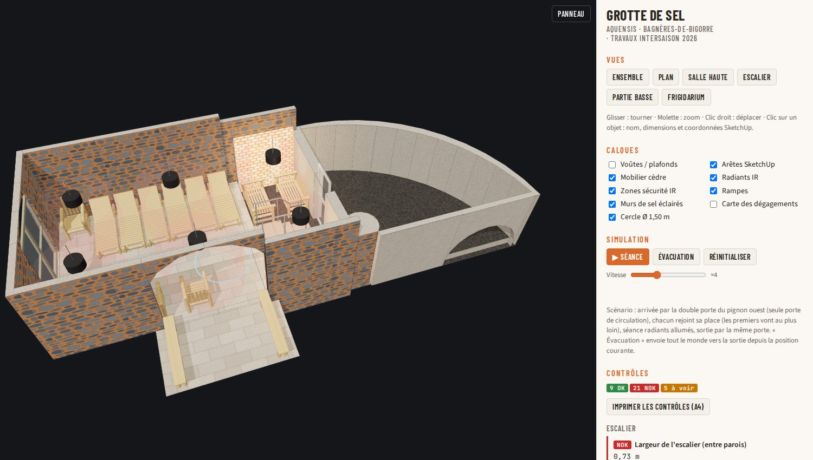
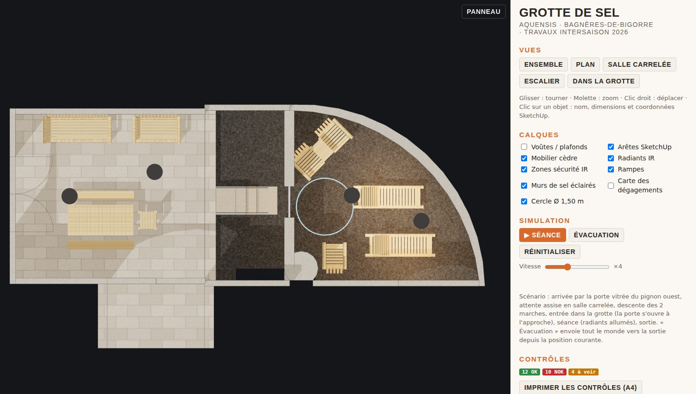
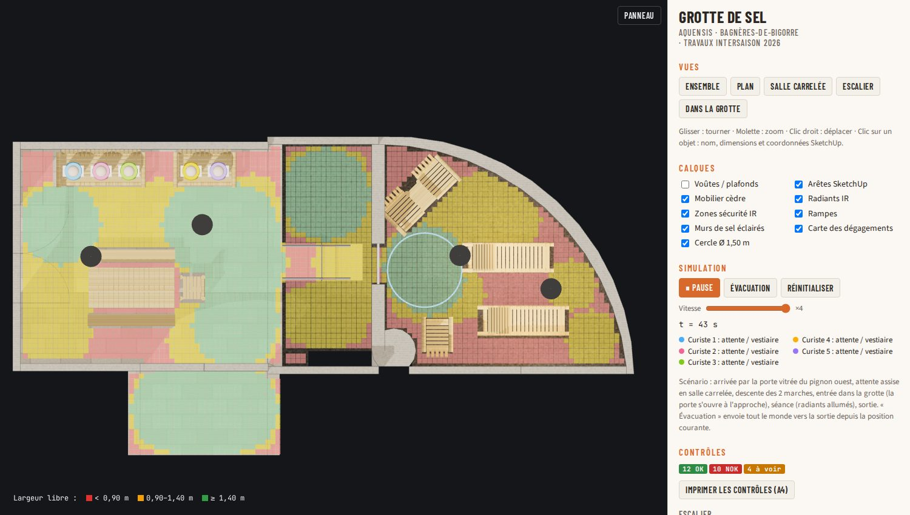
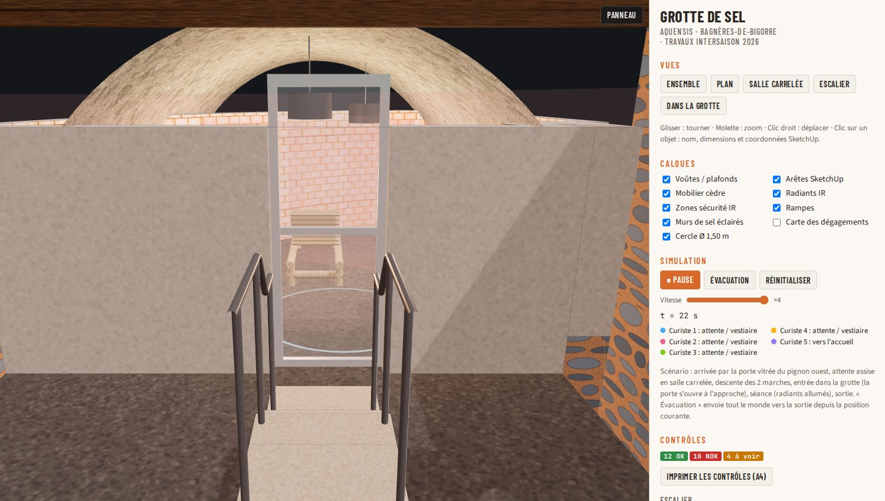
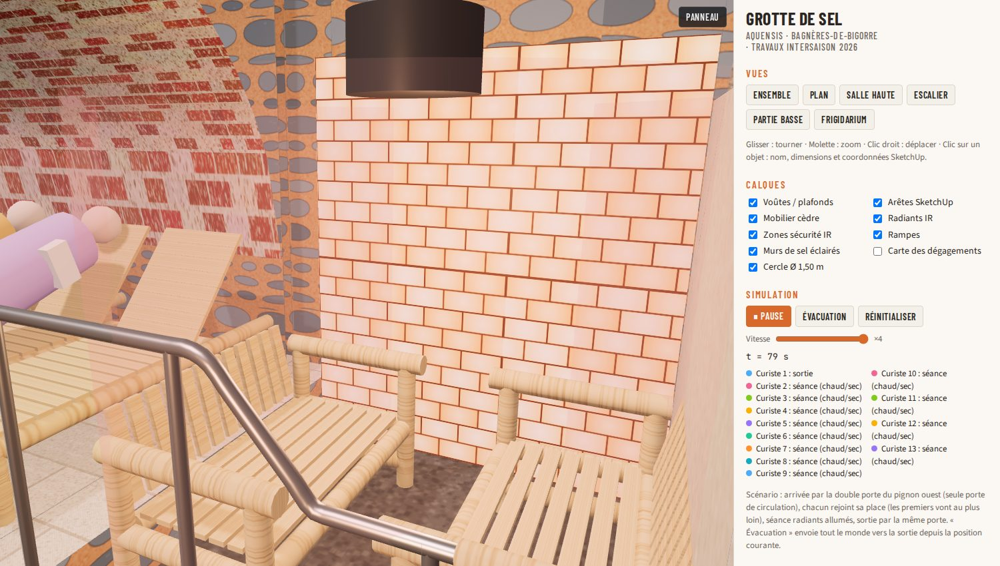

# Grotte de sel — Aquensis (travaux intersaison 2026)

Maquette 3D interactive de la future grotte de sel, construite à partir du SketchUp `model/grotte_de_sel1.skp`,
avec le mobilier Cèdre & Rondins, les 2 poêles de sauna, le déshumidificateur mural, les mains courantes, les deux murs de sel
rétro-éclairés, un contrôle automatique des dégagements et une simulation de circulation des curistes.
Les radiants infrarouges étudiés au départ restent comparables dans le menu (docs/RADIANTS_IR.md).



## Ouvrir la maquette (Windows)

1. Sur GitHub : bouton vert **Code → Download ZIP**, puis clic droit sur le ZIP → **Extraire tout**.
2. Double-cliquer sur `index.html` (Edge ou Chrome). Tout fonctionne hors ligne (Three.js est inclus dans `js/vendor`).

Commandes : glisser = tourner, molette = zoom, clic droit = déplacer, clic sur un objet = nom, dimensions et
coordonnées X/Y/Z dans le repère SketchUp.

| Vue | Contenu |
|---|---|
|  | **Plan** : implantation vue de dessus |
|  | **Carte des dégagements** : rouge < 0,90 m, orange 0,90–1,40 m, vert ≥ 1,40 m |
|  | **Escalier** : 2 marches, avancée de 0,73 m, mains courantes, porte du frigidarium |
|  | **Partie basse** : murs de sel rétro-éclairés, canapés B6 KD face aux 2 poêles de sauna |

## Ce que fait la maquette

- **Géométrie** : lue directement dans le `.skp` (447 sommets, 734 arêtes, 280 faces) par `tools/skp_extract.py`.
- **Textures** : moellons gris-bleu à joints orangés, plafond plat en lames de bois sur solives (grotte), dallage pierre, chape sombre,
  croûte de sel blanche (voûte de la salle 2, d'après les photos), briques de sel de l'Himalaya rétro-éclairées.
- **Équipements** (`js/layout.js`, d'après le plan annoté `docs/plan_annote.jpg`) :
  - salle haute : 6 chaises longues B17 et 4 fauteuils B4A KD ;
  - partie basse : 2 canapés B6 KD face à 2 poêles de sauna de 6 kW, avec garde-corps, au fond de part et d'autre de la porte du frigidarium, et les 2 murs de sel (nord et sud) ;
  - alcôve sud, ouverte sur la salle haute : 1 banc B20B et le déshumidificateur Microwell DRY 500 Silver au mur est, avec son volume à laisser libre ;
  - 2 mains courantes inox à 0,90 m.
- **Chauffage et humidité** : bilan paroi par paroi dans [docs/BILAN_THERMIQUE.md](docs/BILAN_THERMIQUE.md). Il conclut à 12 kW installés, à une régulation maison
  avec limiteurs de sécurité, à de l'air neuf à ne pas prendre dans la pièce d'entrée, et au plafond sous la route à isoler avec un pare-vapeur.
- **Locaux** : la grotte de sel, chaude et sèche, comprend la salle haute, la partie basse et l'alcôve (≈ 85 m³). Le frigidarium, froid et humide, est derrière la porte
  vitrée de 0,80 m (vue rivière).
- **Simulation** : bouton **Séance** — arrivée par la double porte du pignon ouest (seule porte de circulation),
  chacun rejoint sa place, séance (poêles allumés), sortie. Les places sans chemin d'accès restent vides.
  Bouton **Évacuation** — tout le monde rejoint la sortie, avec le temps mesuré.
- **Contrôles** : liste OK / NOK / à voir dans le panneau, imprimable en A4 (bouton « Imprimer les contrôles »).
  Résumé dans [docs/CONTROLES.md](docs/CONTROLES.md).

## Modifier l'aménagement

Tout se règle dans **`js/layout.js`** (Bloc-notes suffit) : position `x`, `y` en mm dans le repère SketchUp,
orientation `rot` en degrés, liste des murs de sel éclairés, modèle de radiant (irModele), plafonds.
Recharger la page (F5) : les contrôles se recalculent.

Si le SketchUp change, régénérer la géométrie (Python 3 installé) :

```
py tools\skp_extract.py model\grotte_de_sel1.skp js\model-data.js
```

## Hypothèses à confirmer sur place

- **Alcôve** : le SketchUp ne dessine que son sol et ferme son ouverture par un mur plein. Murs et voûte (naissance 1,81 m, clé 2,48 m)
  sont pris d'après l'arc d'entrée, et l'ouverture est constatée sur place.
- **Plafond sous la route** : nature et épaisseur de la voûte, poutrelles éventuelles, infiltrations.
- **Voûte du frigidarium** : non dessinée dans le SketchUp, prise d'après les photos (berceau naissant au sol, clé 2,50 m).
- **Positions exactes** : les meubles et les lampes IR sont reportés depuis une photo en perspective du plan ; à ajuster
  dans `js/layout.js` si besoin.

## Arborescence

```
index.html              visionneuse (ouvrir ce fichier)
js/layout.js            aménagement modifiable
js/app.js               scène, contrôles, simulation
js/furniture.js         mobilier paramétrique + radiant
js/textures.js          textures procédurales
js/model-data.js        géométrie extraite du .skp (générée)
tools/skp_extract.py    extracteur SketchUp -> JS
model/                  fichier SketchUp source
docs/photos/            photos du chantier
docs/references/        notices (Trotec, Dimplex, THSL)
docs/BILAN_THERMIQUE.md bilan thermique, humidité, condensation
docs/CONTROLES.md       synthèse des contrôles
docs/RADIANTS_IR.md     comparatif des radiants infrarouges
js/ir-models.js         caractéristiques des radiants (notices)
docs/plan_annote.jpg    plan annoté à la main (référence de l'aménagement)
```
