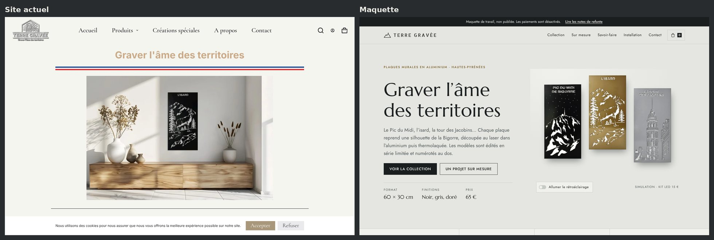
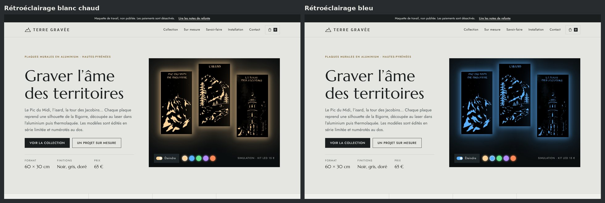
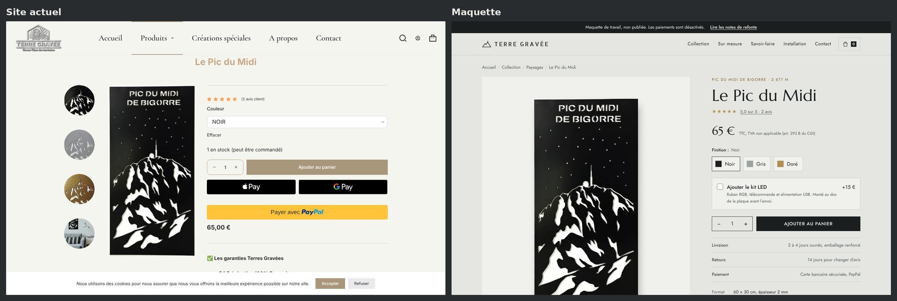
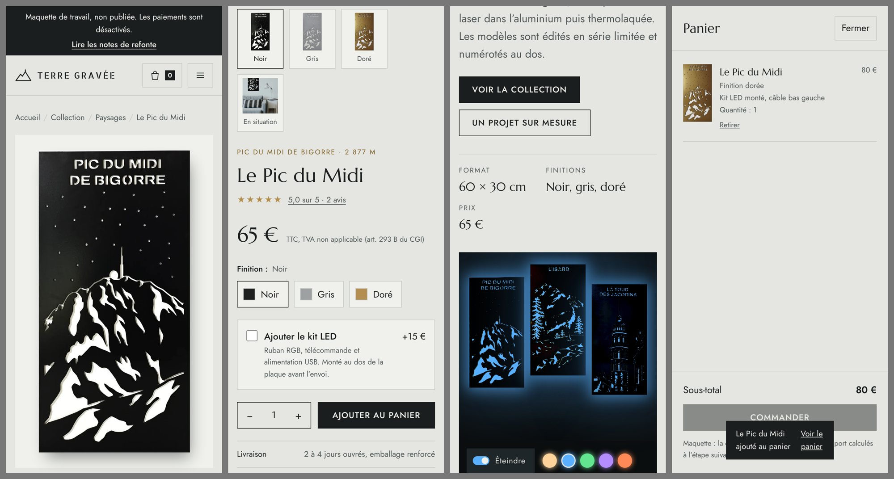
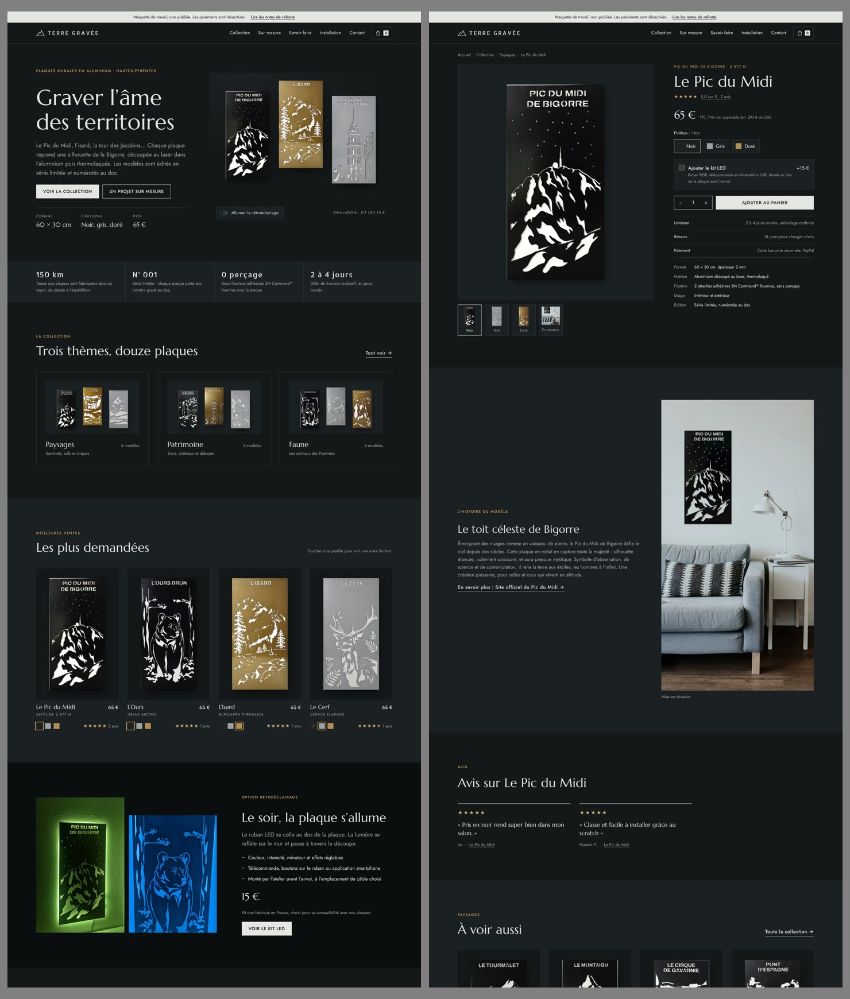

# Maquette Terre Gravée

Brouillon de refonte de [terregravee.fr](https://terregravee.fr), construit à partir du contenu public du site : textes, photos, prix et avis clients. Le site en ligne n'est pas modifié. Aucun paiement n'est possible dans la maquette et les formulaires n'envoient rien.

## Voir la maquette sous Windows

1. Sur GitHub, ouvrir la branche `claude/terre-gravee-access-r9qvzd`, puis **Code › Download ZIP**.
2. Dézipper l'archive, ouvrir le dossier `maquette` et double-cliquer sur `index.html`.

Une connexion internet est nécessaire pour charger les polices. Tout le reste fonctionne hors ligne.

## Aperçu

Accueil, avant et après :



Simulation du kit LED sur l'accueil (bouton « Allumer le rétroéclairage ») :



Fiche produit, avant et après :



Sur téléphone, et en mode sombre :





## Pages

| Fichier | Contenu |
|---|---|
| `index.html` | Accueil : mur d'exposition avec simulation LED, collections, meilleures ventes, avis |
| `collection.html` | Toutes les plaques, filtres par thème, bouton « Voir en noir, gris ou doré » |
| `produit-*.html` | Une fiche par plaque, plus le kit LED et la carte cadeau |
| `sur-mesure.html` | Créations spéciales et formulaire de demande guidé |
| `savoir-faire.html` | L'atelier et les étapes de fabrication |
| `installation.html` | Pose sans perçage et notice du kit LED |
| `contact.html` | Coordonnées, formulaire et questions fréquentes |
| `notes.html` | Ce qui ne va pas sur le site actuel et ce que propose la maquette |

Les informations manquantes sont signalées dans les pages par une étiquette rouge **À COMPLÉTER**.

## Modifier la maquette

Les données des produits sont dans `data/catalogue.json` et les textes des pages dans `build.py`. Après une modification, régénérer les pages avec Python 3.8 ou plus récent :

```
python build.py
```

Les styles sont dans `assets/css/site.css` et le script commun (panier de démonstration, filtres, simulation LED) dans `assets/js/site.js`.
