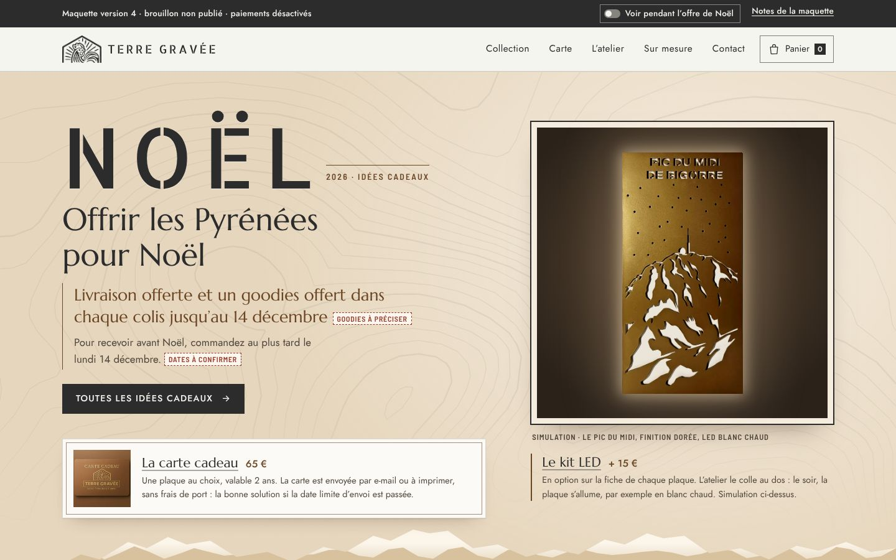
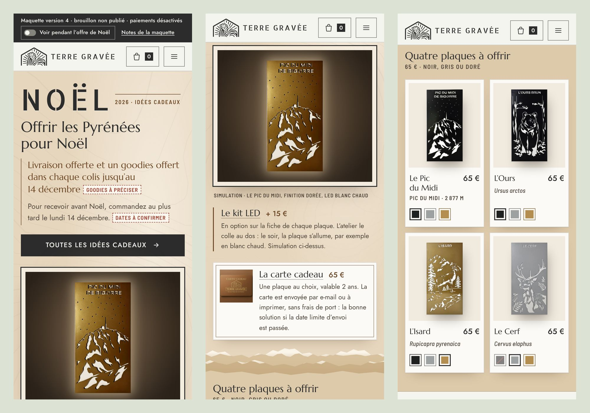
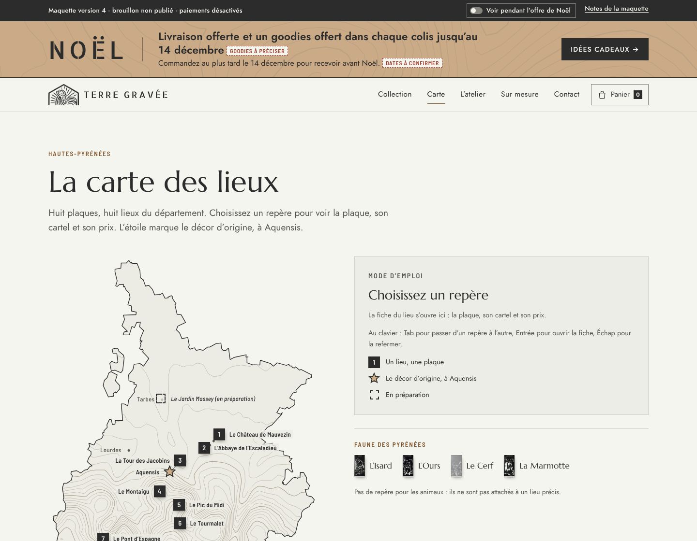
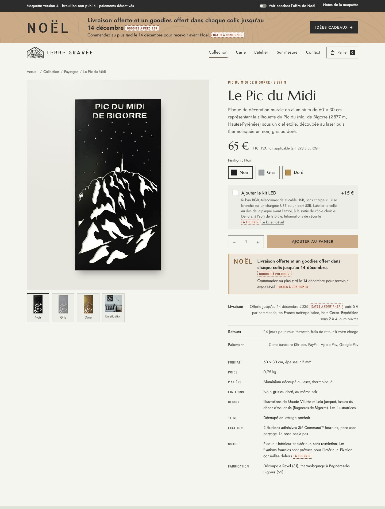

# Terre Gravée · maquette version 4 « Galerie de territoire »

Brouillon de refonte de terregravee.fr, seule maquette gardée depuis le 1er novembre 2026 (les versions 0 et 1 sont retirées ; leur historique reste dans git). La base est une galerie : plaques accrochées avec leur ombre, cartels, fiches claires. S’y ajoutent, en version courte, la carte des lieux, l’histoire d’Aquensis et un paragraphe sur chaque lieu. Les couleurs sont celles de la charte de Romain.

Rien n’est publié : pas de paiement, formulaires simulés (« Maquette : rien n’est envoyé »), panier gardé dans le navigateur.

## Ouvrir

Double-cliquer sur `index.html`. Le dossier est autonome : photos et dessins dans `assets/img/` (dimensions dans `assets/img/_sizes.json`), catalogue dans `data/catalogue.json`, polices dans `assets/fonts/`. Aucune connexion internet n’est nécessaire.

## Ce que contient la maquette

**Pour choisir une plaque :** l’accueil en mur d’exposition avec l’interrupteur de rétroéclairage et ses cinq couleurs ; les cartes à pastilles noir, gris, doré ; les filtres par thème et « Voir en » de la collection ; la fiche produit (prix en tête, option kit LED avec sortie du câble, trois garanties, caractéristiques, barre d’achat collante sur mobile) ; la bande de repères ; le panier en tiroir ; la page Installation ; le relevé des problèmes du site actuel.

**Pour raconter le territoire :** une carte SVG des Hautes-Pyrénées à repères numérotés (8 lieux, Aquensis, 1 modèle en préparation ; plus de repère pour l’adresse de Gerde, qui ne reçoit pas de public), une petite fiche par repère, la liste des lieux dessous, la faune sur une ligne ; des courbes de niveau discrètes derrière le mur et sur la carte ; l’histoire d’Aquensis avec la photo réelle ; le paragraphe « Le lieu » de chaque fiche ; le trajet de Revel à Bagnères-de-Bigorre dans les quatre étapes ; le bloc « Bientôt » ; `qr.html` ; l’essentiel de la stratégie dans `notes.html`.

**Le bloc de Noël (refait le 1er novembre 2026) :** la vitrine de l’atelier la veille de Noël. Un panneau kraft, « NOËL » au pochoir, l’offre et la date limite tenues par un filet fin, une grande plaque dorée rétroéclairée en blanc chaud dans une niche encadrée, avec son cartel « Simulation », le kit LED et la carte cadeau (double filet, comme un bon cadeau imprimé). Au bas du panneau, trois plans de crêtes enneigées (SVG dessiné pour l’ambiance) mènent au mur des quatre plaques, d’un kraft plus profond. En mode sombre, le même panneau de nuit : lettres allumées, crêtes bronze, neige au clair de lune, filet cuivre sous l’en-tête. Sur téléphone, la carte cadeau suit directement le kit LED.

**Réponses du 2 novembre 2026 (deuxième tour) :** offre de Noël confirmée (27 novembre au 14 décembre 2026) avec un magnet en ardoise gravée dans chaque colis ; 5 € pour les trois modes de livraison ; plaques en stock ; transport « 4 à 5 jours » à confirmer ; carte cadeau numérique ; médiateur proposé : le CM2C (adhésion à faire) ; RCS Tarbes 941 234 270 ; téléphone de Hostinger ; Matomo réglé selon la CNIL ; languettes Command™ de 3M ; « 160 km autour de Bagnères-de-Bigorre » (Revel à 156 km) ; crédits de la planche et du logo. Le détail est dans `notes.html`.

**Laissé de côté :** grappes, filtres et calques de la carte, idées cadeaux en grille, registre des avis sur l’accueil, mode « carte de nuit » (le mode sombre suit l’appareil), cartouches et graticules.

Garde-fous : 5 entrées de menu, 7 sections sur l’accueil (pendant la saison de Noël, le bloc de Noël passe en tête et reprend « Nos coups de cœur »), trois moments interactifs (la lumière du mur, les pastilles, la carte).

## Pages

| Fichier | Contenu |
|---|---|
| `index.html` | Mur d’exposition et LED, repères, trois collections avec la photo réelle d’une plaque allumée, « Nos coups de cœur », aperçu de la carte, l’atelier (Aquensis et fabrication), lettre avec « Bientôt » ; pendant la saison, bloc de Noël en tête (jusqu’au 14 décembre), qui reprend « Nos coups de cœur » ; bandeau de Noël sur toutes les pages jusqu’au 24 décembre ; interrupteur d’aperçu « Voir pendant l’offre de Noël » dans le bandeau de la maquette |
| `collection.html` | Les 12 plaques, le kit LED et la carte cadeau ; filtres par thème, « Voir en noir, gris ou doré » |
| `carte.html` | La carte des lieux, sa fiche, la faune, la liste des lieux (l’étoile marque le décor d’origine à Aquensis) |
| `produit-*.html` | 14 fiches : 12 plaques (achat, puis le lieu et l’histoire du modèle), kit LED (présenté comme option d’une plaque, sans bouton d’achat), carte cadeau |
| `atelier.html` | L’origine à Aquensis, la fabrication, les illustratrices, la politique des avis (aucun avis affiché depuis le 31 octobre 2026 : les 9 avis du site actuel ne sont pas repris) |
| `sur-mesure.html` | Adapter un modèle, grands formats (60 × 120 cm, 150 €), délai et acompte, dessins inédits, séries, demande de devis |
| `installation.html` | Pose sans perçage et notice du kit LED |
| `contact.html` | Coordonnées et adresse postale (pas d’accueil du public), formulaire, « Renoncer au contrat ici » en deux étapes, questions fréquentes |
| `qr.html` | Le décor d’Aquensis et les 12 plaques (hors menu). Le QR code des panneaux d’Aquensis contient https://www.terregravee.fr et mène à l’accueil : usage de la page à décider |
| `mentions-legales.html`, `cgv.html`, `confidentialite.html` | Pages légales, liées depuis le pied de page : éditeur et hébergeur ; CGV pour la vente à distance (encadré officiel des garanties légales, formulaire type de rétractation) ; confidentialité et cookies. Sources officielles citées en commentaire dans `build.py`, marqueurs pour ce qui manque |
| `notes.html` | Notes pour Romain : relevé du site actuel, techniques sourcées, palette, idées, points légaux, à fournir, à valider |

**Recherches IA (1er novembre 2026) :** données structurées JSON-LD (produits, entreprise, fil d’Ariane, questions fréquentes, sans aucune note ni avis), vérifiées à chaque construction ; `build.py` écrit aussi `robots.txt`, `sitemap.xml` et `llms.txt`, à déployer à la racine de terregravee.fr à la mise en ligne seulement (fichiers générés : ne pas les modifier à la main). `llms.txt` : faible preuve, coût nul ; aucun grand moteur ne documente qu’il lit ce fichier, et il ne contient que des faits déjà visibles. À la mise en ligne, ne déployer que les pages publiques (.html, dont `qr.html`), `assets/`, `robots.txt`, `sitemap.xml` et `llms.txt` : jamais `build.py`, `data/`, `README.md`, `notes.html`, `captures/`, `__pycache__/` ni `assets/img/_sizes.json`. Le plan d’action pour le site actuel est dans `notes.html`, section « Être trouvé par les recherches IA ».

Les étiquettes **À FOURNIR** et **À CONFIRMER** signalent ce qui manque ; les marqueurs de décision (par exemple **VILLE AU CENTRE À CHOISIR** ou **TARIF PAR MODE À CONFIRMER**) ce qui demande un choix. L’étiquette neutre **En préparation** marque les modèles annoncés.

## Modifier

Textes et structure dans `build.py` (dont `LIEU_TEXTE`, `CORRECTIONS`, `LIEUX`, `BIENTOT`), styles dans `assets/galerie.css`, script dans `assets/galerie.js`. Après une modification : `python build.py` (Python 3.8 ou plus récent, bibliothèque standard). Avant la mise en ligne : `python build.py --mise-en-ligne` reconstruit les mêmes pages, liste les marqueurs restants (à fournir, à confirmer, décisions) page par page, et échoue (code 1) tant qu’il en reste ; `notes.html`, non déployée, n’est pas contrôlée. Le script écrit aussi `assets/img/courbes.svg` et vérifie les liens locaux. Contrôle facultatif : si la variable d’environnement `TG_MOTIFS_INTERDITS` contient une expression régulière (gardée hors du dépôt), la construction s’arrête quand une page la contient.

Les deux dessins de `assets/img/` (La Transhumance, L’iris) ont été recadrés une fois avec Pillow dans la planche `misc/autres-plaques.webp` de l’ancienne v0 (retirée, toujours dans l’historique git). La planche affichée sur les pages L’atelier et Sur mesure, `assets/img/planche-dessins-inedits.webp`, est une copie de cette planche faite avec Pillow : la vignette du Casque du Lhéris est retirée et les suivantes de la première rangée sont décalées d’un cran (dix-sept dessins). Le contour du département (`data/hautes-pyrenees.json`) est simplifié d’après les données IGN (Licence Ouverte 2.0).

Logo : `assets/img/logo-embleme.webp` (en-tête, à côté du nom au pochoir) et `assets/img/logo-complet.webp` (pied de page), éclaircis par `filter: invert(.92)` sur fond sombre.

Polices : Marcellus, Jost, Barlow Semi Condensed et Allerta Stencil, en woff2 (sous-ensemble latin) dans `assets/fonts/`, déclarées en tête de `assets/galerie.css` avec `font-display: swap`. Elles sont sous licence SIL Open Font License 1.1 (textes de licence `assets/fonts/OFL-*.txt`, à garder avec les fichiers). Aucune requête vers Google Fonts : l’adresse IP des visiteurs n’est pas transmise à Google.

Fichier unique : `python3 ../../outils/regrouper.py . ../../fichiers-uniques/terre-gravee-v4-galerie-de-territoire.html "Terre Gravée · Galerie de territoire (v4)"`.
