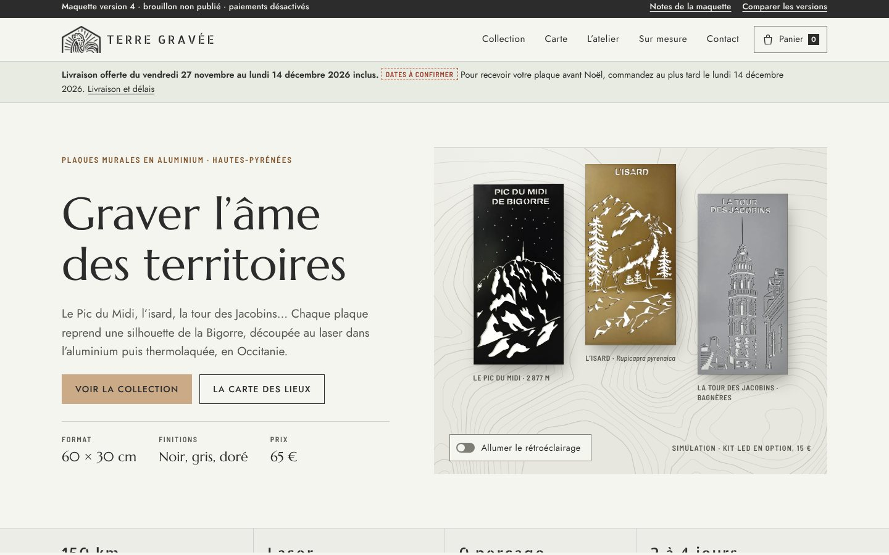
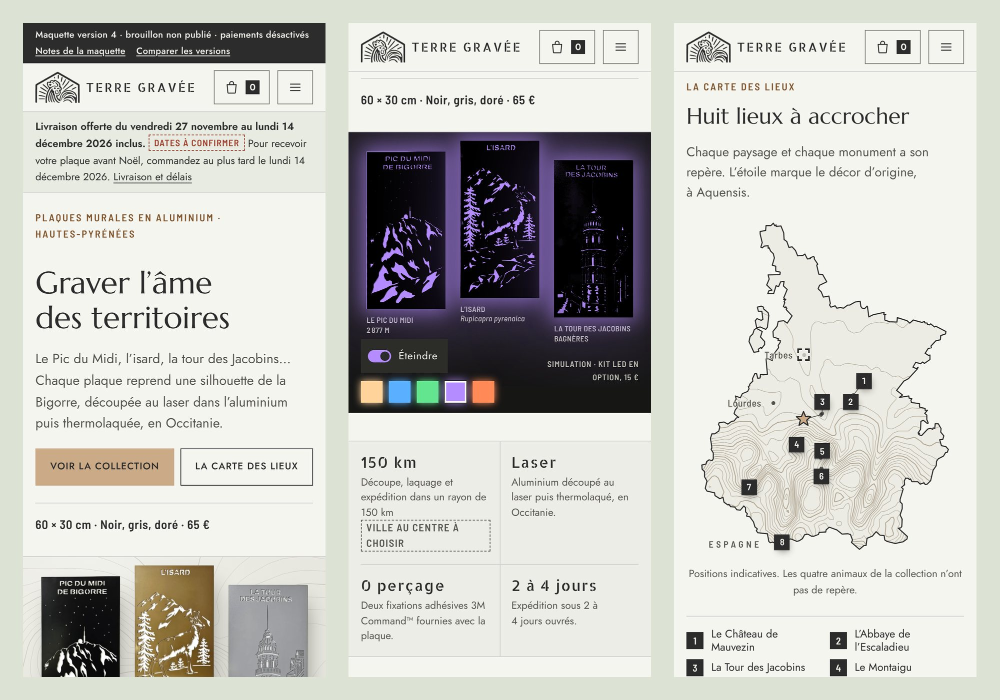
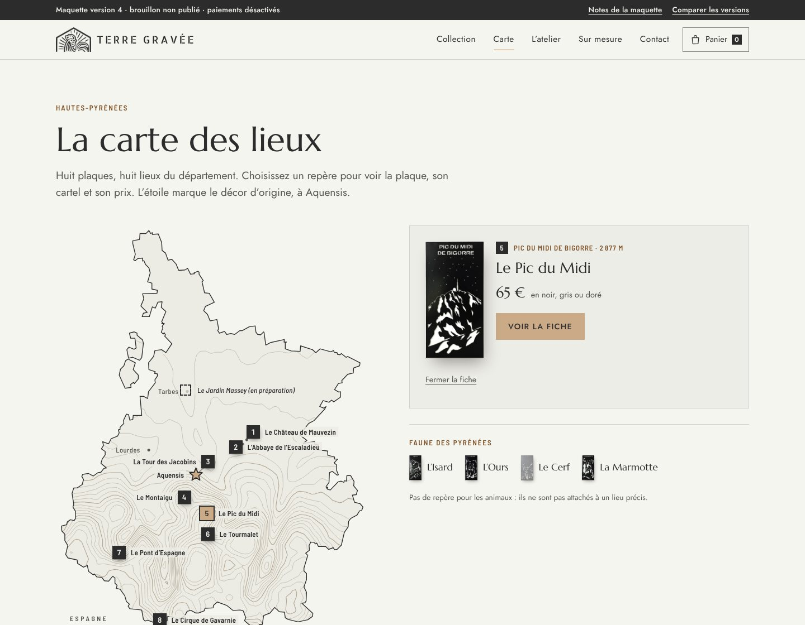
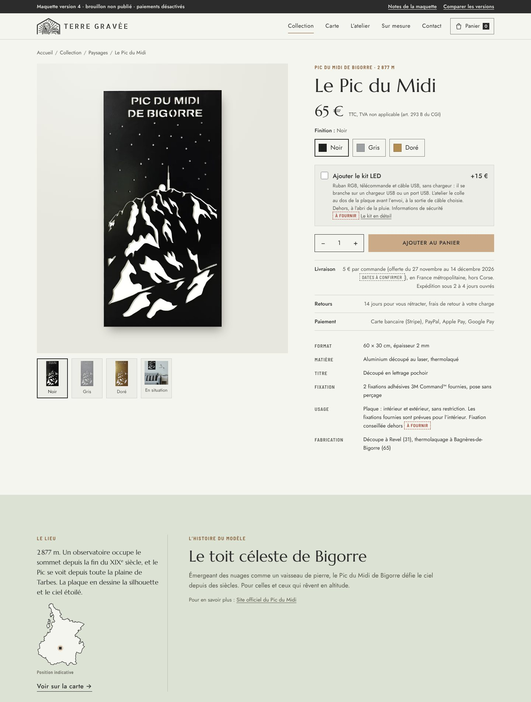

# Terre Gravée · maquette version 4 « Galerie de territoire »

Brouillon de refonte de terregravee.fr, version retenue. Elle mélange le **mur d’exposition** (v0), jugé trop simple, et le **carnet de territoire** (v1), jugé trop complexe. La base reste la galerie de la v0 : plaques accrochées avec leur ombre, cartels, fiches claires. La v1 apporte, en version courte, la carte des lieux, l’histoire d’Aquensis et un paragraphe sur chaque lieu. Les couleurs sont celles de la charte de Romain.

Rien n’est publié : pas de paiement, formulaires simulés (« Maquette : rien n’est envoyé »), panier gardé dans le navigateur.

## Ouvrir

Double-cliquer sur `index.html`. Les images sont lues dans `../../maquette/assets/img/` : le dossier `maquette` doit rester à côté du dossier `versions`. Une connexion internet est nécessaire pour les polices.

## Ce qui vient de chaque version

**De la v0 :** l’accueil en mur d’exposition avec l’interrupteur de rétroéclairage et ses cinq couleurs ; les cartes à pastilles noir, gris, doré ; les filtres par thème et « Voir en » de la collection ; la fiche produit (prix en tête, option kit LED avec sortie du câble, trois garanties, caractéristiques, barre d’achat collante sur mobile) ; la bande de repères ; le panier en tiroir ; la page Installation ; le relevé des problèmes du site actuel.

**De la v1, simplifié :** une carte SVG des Hautes-Pyrénées à repères numérotés (8 lieux, Aquensis, 1 modèle en préparation ; plus de repère pour l’adresse de Gerde, qui ne reçoit pas de public), une petite fiche par repère, la liste des lieux dessous, la faune sur une ligne ; des courbes de niveau discrètes derrière le mur et sur la carte ; l’histoire d’Aquensis avec la photo réelle ; le paragraphe « Le lieu » de chaque fiche ; le trajet de Revel à Bagnères-de-Bigorre dans les quatre étapes ; le bloc « Bientôt » ; `qr.html` ; l’essentiel de la stratégie dans `notes.html`.

**Laissé de côté :** grappes, filtres et calques de la carte, idées cadeaux en grille, registre des avis sur l’accueil, mode « carte de nuit » (le mode sombre suit l’appareil), cartouches et graticules.

Garde-fous : 5 entrées de menu, 7 sections sur l’accueil, trois moments interactifs (la lumière du mur, les pastilles, la carte).

## Pages

| Fichier | Contenu |
|---|---|
| `index.html` | Mur d’exposition et LED, repères, trois collections avec la photo réelle d’une plaque allumée, « Nos coups de cœur », aperçu de la carte, l’atelier (Aquensis et fabrication), lettre avec « Bientôt » ; annonce de fin d’année en tête |
| `collection.html` | Les 12 plaques, le kit LED et la carte cadeau ; filtres par thème, « Voir en noir, gris ou doré » |
| `carte.html` | La carte des lieux, sa fiche, la faune, la liste des lieux (l’étoile marque le décor d’origine à Aquensis) |
| `produit-*.html` | 14 fiches : 12 plaques (achat, puis le lieu et l’histoire du modèle), kit LED (présenté comme option d’une plaque, sans bouton d’achat), carte cadeau |
| `atelier.html` | L’origine à Aquensis, la fabrication, les illustratrices, la politique des avis (aucun avis affiché depuis le 31 octobre 2026 : les 9 avis du site actuel ne sont pas repris) |
| `sur-mesure.html` | Adapter un modèle, grands formats (60 × 120 cm, 150 €), délai et acompte, dessins inédits, séries, demande de devis |
| `installation.html` | Pose sans perçage et notice du kit LED |
| `contact.html` | Coordonnées et adresse postale (pas d’accueil du public), formulaire, « Renoncer au contrat ici » en deux étapes, questions fréquentes |
| `qr.html` | Accueil des visiteurs qui scannent le QR code d’un panneau d’Aquensis (hors menu) |
| `notes.html` | Notes pour Romain : relevé du site actuel, techniques sourcées, palette, idées, points légaux, à fournir, à valider |

Les étiquettes **À FOURNIR** et **À CONFIRMER** signalent ce qui manque ; les marqueurs de décision (par exemple **VILLE AU CENTRE À CHOISIR** ou **TARIF PAR MODE À CONFIRMER**) ce qui demande un choix. L’étiquette neutre **En préparation** marque les modèles annoncés.

## Modifier

Textes et structure dans `build.py` (dont `LIEU_TEXTE`, `CORRECTIONS`, `LIEUX`, `BIENTOT`), styles dans `assets/galerie.css`, script dans `assets/galerie.js`. Après une modification : `python build.py` (Python 3.8 ou plus récent, bibliothèque standard). Le script écrit aussi `assets/img/courbes.svg` et vérifie les liens locaux. Contrôle facultatif : si la variable d’environnement `TG_MOTIFS_INTERDITS` contient une expression régulière (gardée hors du dépôt), la construction s’arrête quand une page la contient.

Les trois dessins de `assets/img/` (Le Casque du Lhéris, non annoncé et donc non affiché, La Transhumance, L’iris) ont été recadrés une fois avec Pillow dans la planche `misc/autres-plaques.webp`. La planche affichée sur les pages L’atelier et Sur mesure, `assets/img/planche-dessins-inedits.webp`, est une copie de cette planche faite avec Pillow : la vignette du Casque du Lhéris est retirée et les suivantes de la première rangée sont décalées d’un cran (dix-sept dessins). Le contour du département (`data/hautes-pyrenees.json`) est simplifié d’après les données IGN (Licence Ouverte 2.0).

Logo : `assets/img/logo-embleme.webp` (en-tête, à côté du nom au pochoir) et `assets/img/logo-complet.webp` (pied de page), éclaircis par `filter: invert(.92)` sur fond sombre.
